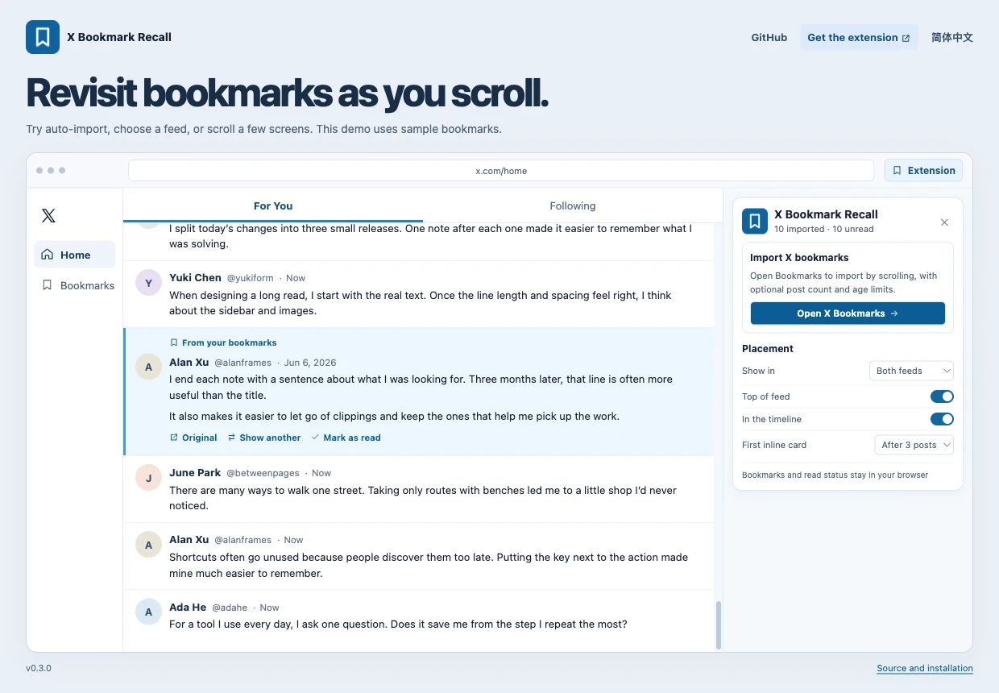

<p align="right"><a href="README.md">中文</a></p>

<p align="center">
  
</p>

<p align="center">
  <a href="https://xiaosang.cc/x-bookmark-recall/?lang=en">▶ Try the Demo</a>
  ·
  <a href="https://github.com/holynova/x-bookmark-recall/releases/tag/v0.3.0">Download v0.3.0</a>
  ·
  <a href="https://github.com/holynova/x-bookmark-recall">GitHub Repository</a>
</p>

**X Bookmark Recall** is a Chrome extension that brings your saved posts back into the X feed. Read the imported text inline, open the original, swap the card, or mark it as read — bookmarks stop being a write-only archive and resurface while you scroll.

## Screenshots

<p align="center">
  
</p>

<p align="center">
  
</p>

Screenshots and the online demo use sample data.

## Get Started

1. **Install**: download and unzip the extension. Open `chrome://extensions/`, turn on Developer mode, then choose 「加载已解压的扩展程序」 ("Load unpacked") and select the folder containing `manifest.json`. To update an existing installation, replace the files in its original folder and click 「重新加载」 ("Reload").
2. **Import**: sign in to X and refresh the page. Open Bookmarks from the extension popup and start 「自动滚动导入」 ("Scroll and import"). Both the item limit and the post-age limit are optional; duplicates count toward the item limit.
3. **Recall**: return to the home feed. Cards appear in both 「为你推荐」 ("For You") and 「正在关注」 ("Following") by default; top and inline placements can be toggled separately.

## As You Scroll

- The first inline card defaults to after the 3rd post (changeable in the popup).
- The next one needs a random gap of 9–15 regular posts plus at least about 3 screens of scrolling; up to 3 extra cards per visit, with one shared allowance across both feeds.
- Older unread posts are favored; recently shown or skipped bookmarks rest (3-day cooldown after a skip).
- Scrolling back to the same insertion point restores the same card — it never swaps in a new one.

## Features

- **Stored locally**: bookmarks and read status stay in your browser (`storage` + `unlimitedStorage`); nothing is uploaded. Reads can be undone.
- **Two feeds**: For You / Following can each be shown alone or both together; top-of-feed and inline placements toggle independently.
- **Card actions**: 「原帖」 ("Original post" — opens the original), 「换一条」 ("Swap" — draws another candidate card), 「标为已读」 ("Mark as read"); if X shows only an excerpt on the Bookmarks page, open the original to read the full post.
- **Controlled import**: auto-scroll import takes an item limit and a post-age limit; you can also import only the bookmarks already loaded, or keep collecting while scrolling.

## Develop

```bash
npm ci
npm run check   # syntax checks + unit tests
npm test        # node --test (5 test files)
```

Load `extension/` directly in Chrome to debug; `site/` is the online demo (sample data). The installed extension's controls are currently in Chinese.

## Tech

- Manifest V3 (Chrome ≥ 114), zero dependencies: vanilla JS + CSS under `extension/`.
- Content scripts inject into `x.com`: `x-page.js` reads the timeline structure, `card.js` renders recall cards, `auto-import.js` scroll-imports bookmarks, `scroll-recall.js` controls insertion pacing, `content.js` coordinates placement and interaction; `worker.js` is the background Service Worker, `model.js` manages bookmark data and the draw strategy.
- Insertion pacing follows deterministic rules, not random placement: a 9–15 post gap plus 3 screens of scrolling, a 3-card cap per visit, and a 3-day cooldown after a skip — all verifiable in `scroll-recall.js` and `followups.js`.

```
extension/              Chrome extension (Manifest V3, v0.3.0)
  manifest.json         Permissions: storage, unlimitedStorage; matches https://x.com/* only
  content.js            Coordinates card placement and interaction
  x-page.js             Reads the X timeline structure
  card.js / card.css    Recall card rendering and styles
  auto-import.js        Auto-scroll bookmark import
  scroll-recall.js      Insertion pacing (gap / screens)
  followups.js          Follow-up card allowance and cooldown
  model.js              Bookmark data and draw strategy
  worker.js             Background Service Worker
  popup.html/js/css     Extension popup (import + settings)
site/                   Online demo site (demo.js + style.css)
test/                   5 unit tests (node --test)
assets/readme/          Hero images and screenshots (Chinese and English sets)
```
