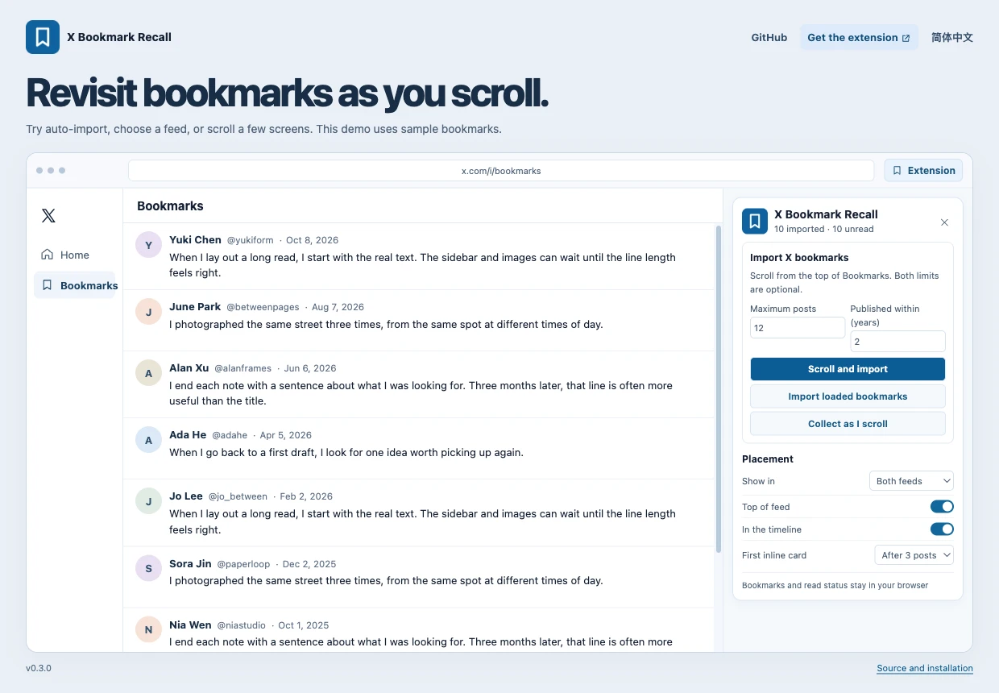

<p align="right"><a href="./README.md">简体中文</a> · English</p>
<p align="center"></p>

**X Bookmark Recall** is a Chrome extension that brings your saved posts back into the X feed. Read the imported text inline, open the original, swap the card, or mark it as read.

[Try the demo](https://xiaosang.cc/x-bookmark-recall/?lang=en) · [Download v0.3.0](https://github.com/holynova/x-bookmark-recall/releases/tag/v0.3.0)


## Get started

1. Download and unzip the extension. Open `chrome://extensions/`, turn on Developer mode, then choose **Load unpacked** and select the folder containing `manifest.json`. To update an existing installation, replace the files in its original folder and click **Reload**.
2. Sign in to X and refresh the page. Open Bookmarks from the extension popup and start **Scroll and import**. Both limits are optional. The count includes duplicate bookmarks encountered during this run, and the age limit uses the post’s publication date.
3. Return to the X home feed. Cards appear in both **For You** and **Following** by default. You can select a single feed and toggle the top and inline placements separately.



## What happens as you scroll

The first inline card defaults to after three regular posts. The next placement requires a random gap of 9–15 regular posts and at least about three screens of scrolling. Each visit has up to three extra cards, with one shared allowance across both feeds. The selection favors older unread posts and gives recently shown or skipped posts a break. Scrolling back to the same insertion point restores its card.

Your bookmarks and read status stay in your browser. You can undo a read action. When X exposes only an excerpt in Bookmarks, use **Original** to open the rest. The screenshots and online demo use sample content. The installed extension’s controls are currently in Chinese.

<details>
<summary>Develop and deploy</summary>

```sh
npm ci
npm run check
npm run dev
npm run deploy:check
```

Load `extension/` directly in Chrome. The portfolio Worker serves the demo. Copy `site/` from the project's committed `main` into `x-bookmark-recall/` on the portfolio's `master`, then deploy with its existing Wrangler configuration.

[GitHub Repo](https://github.com/holynova/x-bookmark-recall)
</details>
