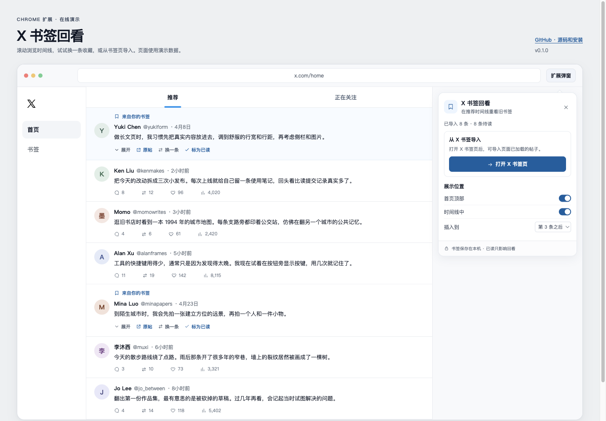

# X 书签回看 / X Bookmark Recall

从 X 书签页导入收藏，在「为你推荐」顶部和时间线内回看。可换一条、标为已读并撤销。导入只读取页面已加载的帖子，书签按账号保存在本机，已读状态只影响扩展内的回看。

A Chrome extension that resurfaces your X bookmarks in the For You feed. Import the posts loaded on your Bookmarks page, then revisit them at the top of the feed and between regular posts. Bookmark data and read status stay in your browser.



## 在线体验 / Live Demo

- [Cloudflare Demo](https://xiaosang.cc/x-bookmark-recall/)
- [GitHub Repo](https://github.com/holynova/x-bookmark-recall)

在线演示使用模拟数据。安装扩展后才会在真实 X 页面显示你的书签。


## 安装与使用 / Install and use

1. 在 Chrome 或 Chromium 打开 `chrome://extensions/`，开启「开发者模式」。点「加载未打包的扩展程序」，选择本仓库的 `extension/` 目录，刷新 X。
2. 从扩展弹窗打开 X 的书签页，点「导入已加载书签」。也可开启「滚动时继续收集」后向下滚动。离开或刷新书签页会结束连续导入。
3. 回到「为你推荐」。弹窗可独立开关顶部与时间线卡片，并调整插入位置。视频和完整引用可打开原帖查看。

Load the `extension/` directory as an unpacked extension. In the popup, open X Bookmarks and import the loaded posts. Switch to For You to see the cards. The popup controls both placement options.

## 本地预览 / Local preview

扩展目录无需构建。开发环境命令 / Development commands:

```sh
npm ci
npm run check
npm run dev
npm run deploy:check
```

## 发布 / Deploy

演示由作品集的 `xiaosang-portfolio` Worker 提供。将本仓库 `main` 已提交的 `site/` 静态文件同步到作品集 `master` 的 `x-bookmark-recall/` 后，从同一作品集提交手动部署：

```sh
npx --yes wrangler@4.128.0 deploy --config wrangler.jsonc
```
